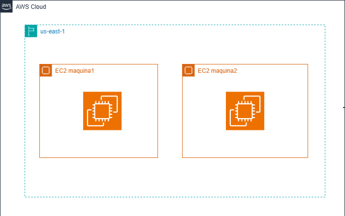

# EXERCICI 1: Primeres instàncies EC2 amb Terraform 

## Objectiu 
Iniciació a l'Infrastructura com a Codi (IaC) utilitzant Terraform per a la creació automatitzada de recursos bàsics a AWS

## Recursos

*   **Región AWS:** us-east-1 
*   **Tipo de instancia:** t3.micro 
*   **Sistema Operativo:** Amazon Linux 2023
*   **Cantidad:** 2 instancias EC2

# PREPARACIÓ DE L'ENTORN
**1. Configuració de CredencialS AWS:** 

Configurem el AWS CLI amb **aws configure**, introduim el Secret Access Key per permitir que Terraform es comuniqui amb AWS
(canvia cada dia, llavors cada dia has de tornar a introduir-la)

## TOPOLOGIA

# INSTRUCCIONS D'EXECUCIÓ CODI TERRAFORM 

## Inicialitzacio del directori
Un cop tenim els fitchers main.tf creats amb el primer pas es inicialitzar el directori

**terraform init**

## Validacio i planificació 
Abans de crear els recursos validarem la sintaxis i visualitzar quins canvis farà terraform

**terraform validate** 

**terraform plan**
## Desplegament de la infraestructura
Un cop revisat el pla i confirmat que és correcte crearem la infraestructura a AWS

**terraform apply**
## Després del desplegament verifiquem 

# VERIFICACIO CONSOLA AWS
Quan executem **terraform apply** accedim a la consola de AWS per verificar que:
*   Les 2 instàncies estàn **Running**.

*   El tipo de instància és **t3.micro** y utilitza la AMI correcte
*   Tenen associat el Security Group que permet el trànsit SSH (port 22).

# FINAL: Neteja de recursos
Per evitar costos innecessaris al compte d'AWS, una vegada realitzades les comprovacions i captures de pantalla executem: 

**terraform destroy**

