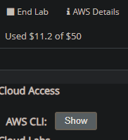
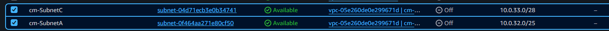
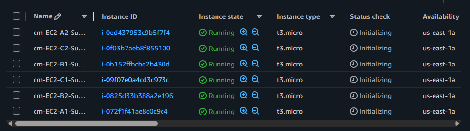

# EXERCICI 2: VPC, Subxarxes i Instàncies EC2 amb Terraform 

## Objectiu 
Automatitzar la creació d'una infraestructura de xarxa a AWS utilitzant Terraform (IaC). Es desplega una VPC personalitzada, 3 subxarxes amb diferents màscares de xarxa i 6 instàncies EC2 distribuïdes (2 per subxarxa), connectades mitjançant interfícies de xarxa (ENI).

## Recursos
*   **Regió AWS:** us-east-1
*   **Tipus d'instància:** t3.micro 
*   **Sistema Operatiu:** Amazon Linux 2023
*   **Quantitat:** 1 VPC, 3 Subxarxes i 6 instàncies EC2.

## Preparació del entorn
**1. Configuració de Credencials AWS:** 
Configurem el AWS CLI amb **aws configure** introduint l'Access Key.

## Topologia

## Verificació en la Consola de AWS
Quan executem **terraform apply**, accedim a la consola de AWS per verificar que:

*   **VPC i Subxarxes:** La VPC **cm-VPC-principal** està creada amb les 3 subxarxes i els seus CIDR correctes
VPC

SUBXARXES

*   **Instàncies EC2:** Les 6 instàncies estan en estat **Running**

## Final: Neteja de recursos
Per evitar costos innecessaris al compte d'AWS, una vegada realitzades les comprovacions i captures de pantalla executem: **destroy**